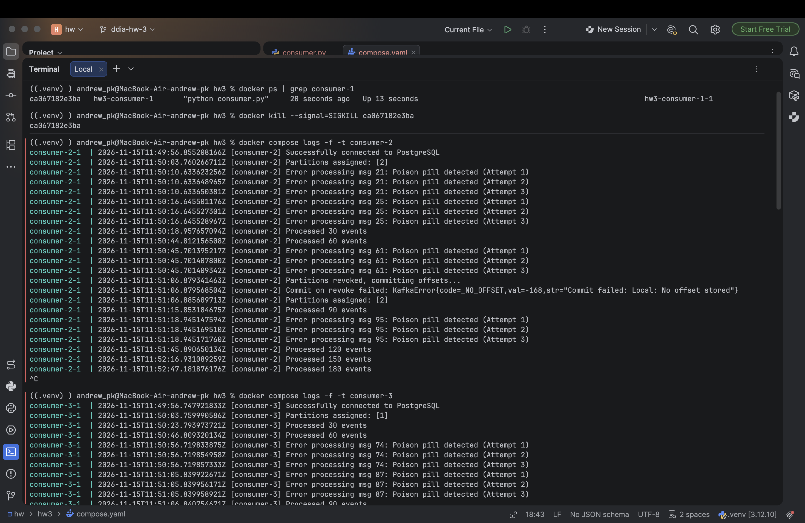
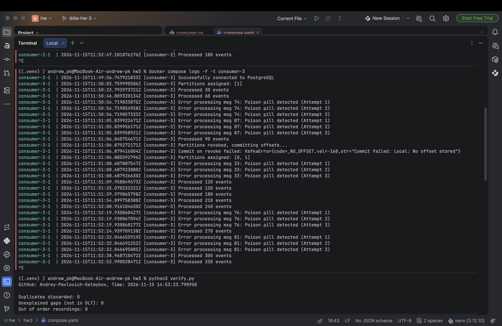
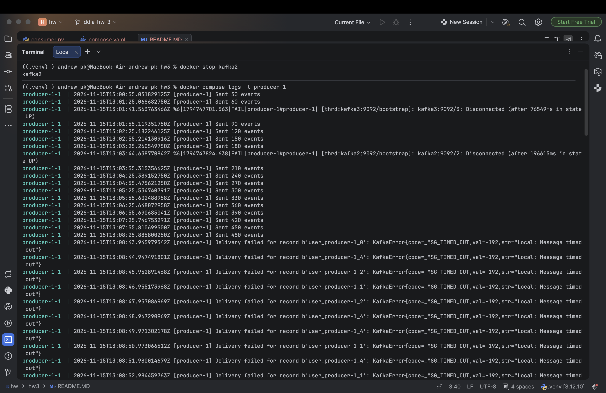
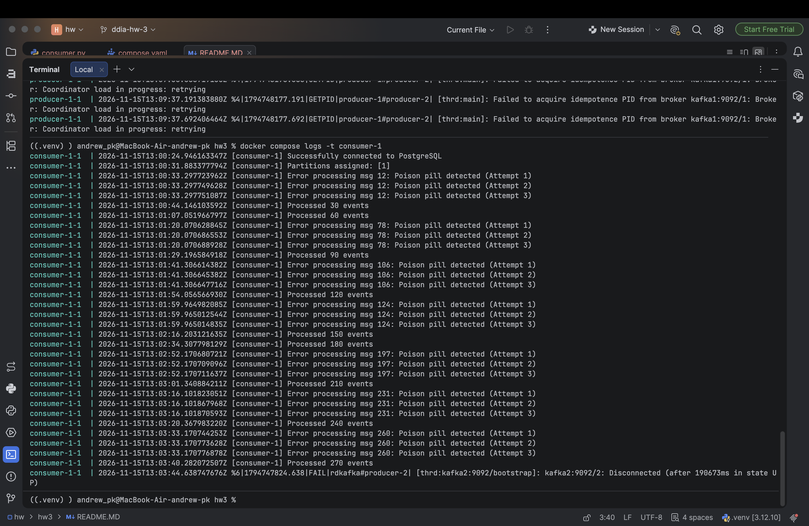
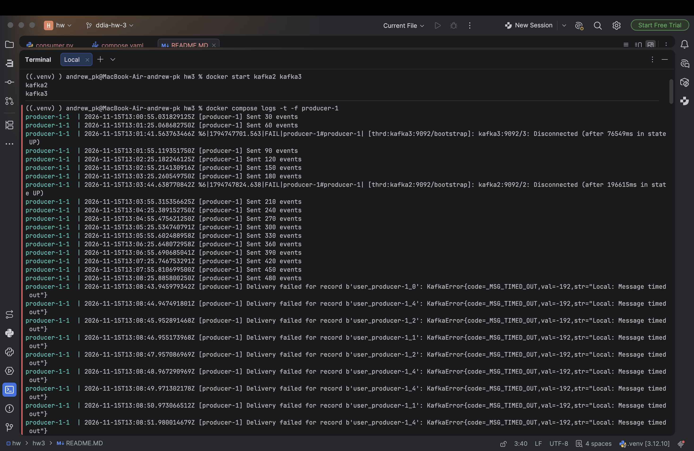
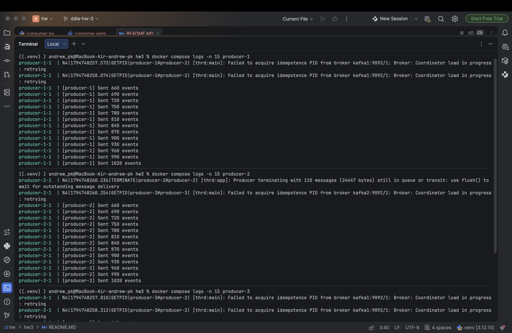
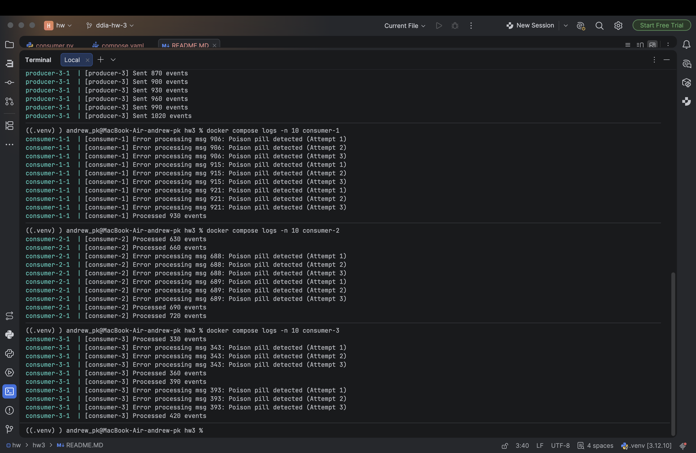
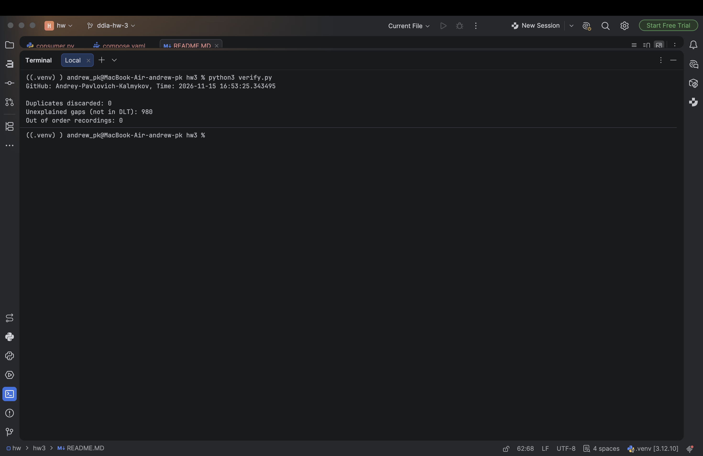
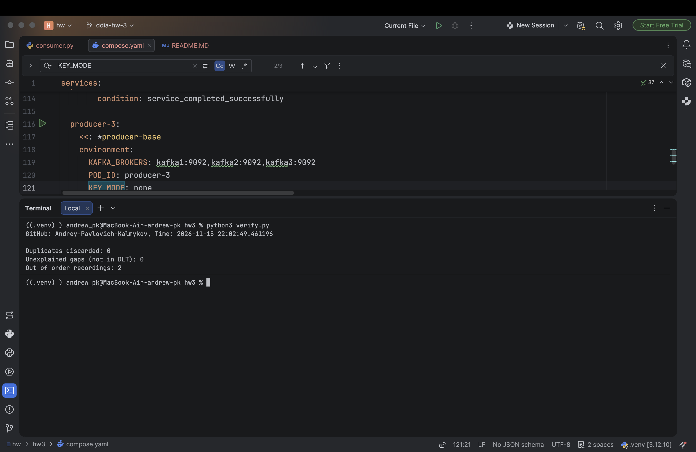

# HW3. Очередь Kafka — эксперименты с отказами

Студент: Andrey-Pavlovich-Kalmykov (MSE, DDIA, осень 2026)

Архитектура решения:

- Кластер Kafka 3.7.0 в режиме KRaft (3 брокера, без ZooKeeper), доступен изнутри compose-сети и с хоста (`localhost:29092–29094`), автосоздание топиков отключено.
- Топики создаёт одноразовый сервис `kafka-setup`: `events` (3 партиции, RF=3, `min.insync.replicas=2`) и `events.dlt` (3 партиции, RF=3).
- 3 продюсера: ключ сообщения — `user_id` (переменная `KEY_MODE=user_id|none`), `acks=all`, `enable.idempotence=true`, ошибки доставки логируются, при SIGTERM буфер сбрасывается через `flush()`. Каждый под обслуживает свой набор пользователей, порядковый номер `seq` ведётся в памяти. ~2% событий — ядовитые.
- 3 консьюмера в группе `events-processor`: автокоммит отключен, оффсет коммитится синхронно только после успешной записи в sink или отправки в DLT; при ребалансе (revoke) обработанные оффсеты коммитируются до отдачи партиций. Ядовитое событие после 3 неудачных попыток уходит в `events.dlt` (в заголовках — причина ошибки и исходные топик/партиция/оффсет), оффсет коммитится. Sink — Postgres, запись идемпотентна по `event_id` (дедупликация), отброшенные дубли считаются отдельным счётчиком.
- `auto.offset.reset=earliest` выбран осознанно: при первом запуске группа должна обработать всё с начала, а при сбросе оффсетов не терять события (at-least-once важнее, чем возможные дубли, которые подавляет дедупликация).
- `verify.py` проверяет: отсутствие пропусков в `seq` (событие не считается потерянным, если оно есть в `events.dlt`), число отброшенных дублей, число нарушений порядка записи.

## Эксперимент 1. Убийство пода-консьюмера (`kill -9`)

**Действие.** Под нагрузкой убит контейнер `hw3-consumer-1-1` командой `docker kill --signal=SIGKILL`.

**Гипотеза.** `kill -9` не даёт процессу отработать SIGTERM, поэтому последний обработанный оффсет может остаться незакоммиченным. Координатор группы узнает о смерти члена только после `session.timeout.ms` (~45 с), затем запустит ребаланс: партию убитого пода получит один из оставшихся консьюмеров и возобновит чтение с последнего закоммиченного оффсета. Возможна повторная доставка незакоммиченных сообщений — дубли будут отброшены идемпотентной записью по `event_id`. Потерь быть не должно.

**Наблюдения.** Ребаланс произошёл спустя ~45 с после убийства. В логах обоих выживших консьюмеров виден revoke с попыткой коммита и новое назначение партиций:

- `consumer-2`: `Partitions revoked, committing offsets...` → `Commit on revoke failed: _NO_OFFSET ("No offset stored")` → `Partitions assigned: [2]` (остался при своей партиции);
- `consumer-3`: revoke с тем же `_NO_OFFSET` → `Partitions assigned: [0, 1]` — забрал партицию убитого `consumer-1` и продолжил обработку без заметной паузы.

`KafkaError{code=_NO_OFFSET}` — ожидаемое поведение, а не сбой: оффсет коммитится после каждого события, поэтому к моменту revoke локально не осталось необработанных оффсетов, досылать было нечего. Обработка продолжилась с уже закоммиченной позиции.

**Результат verify:**

```
GitHub: Andrey-Pavlovich-Kalmykov, Time: 2026-11-15 14:53:23

Duplicates discarded: 0
Unexplained gaps (not in DLT): 0
Out of order recordings: 0
```

**Выводы.** Гипотеза подтверждена частично: ребаланс, перехват партиции и отсутствие потерь — как ожидалось. Дубликатов в этом прогоне не возникло, потому что убитый под не оставил в «воздухе» ни одного события: синхронный коммит после каждой вставки сокращает окно at-least-once до одного in-flight сообщения, и в момент убийства его не оказалось (иначе было бы ровно одно повторение). Система продолжила обработку двумя подами без потерь и нарушений порядка.




## Эксперимент 2. Остановка брокеров

**Действие.** Чистый старт (`docker compose down && up -d`), под нагрузкой последовательно остановлены `kafka3`, затем `kafka2`, наблюдения сняты, затем оба брокера возвращены (`docker compose up -d kafka2 kafka3`).

**Гипотеза.**
- После остановки первого брокера лидеры его партиций переместятся на оставшиеся два (выбор лидера — работа контроллера кластера, останется на живых брокерах). Запись и чтение продолжатся: `acks=all` и `min.insync.replicas=2` по-прежнему выполнимы, так как в ISR остаётся 2 брокера.
- После остановки второго брокера жив только один, ISR=1 < `min.insync.replicas=2`: брокер будет отклонять записи с ошибкой `NotEnoughReplicas`. Продюсеры не получат ack и будут ретраить сообщения в пределах `message.timeout.ms` (5 минут), после чего недоставленные сообщения будут потеряны — появятся пропуски seq, которых нет ни в sink, ни в DLT. Консьюмеры продолжат читать партиции, чьим лидером остался живой брокер.
- После возврата брокеров ISR восстановится, запись возобновится; система в целом заживёт, но пропуски за время полного дауна — невосполнимы.

**Наблюдения.**

1. *Остановка kafka3.* В логах продюсеров и консьюмеров — `Disconnected` по адресу `kafka3:9092`, после чего работа продолжилась без пауз: `Sent N events` / `Processed N events` идут дальше. В выводе `kafka-topics.sh --describe` (выполнялся на живом брокере) видно, что лидерство всех партиций `events` и `events.dlt` перешло к брокерам 1 и 2 — это и есть выбор нового лидера контроллером.

2. *Остановка kafka2.* Запись стала невозможной: брокер отклоняет её (`NotEnoughReplicas`, ISR=1 < min.insync.replicas=2). Первые ~5 минут в логах продюсеров тишина — librdkafka ретраит внутри себя; затем пошли `Delivery failed ... _MSG_TIMED_OUT ("Local: Message timed out")`: ретраи исчерпались, сообщения, сгенерированные в окне полной недоступности, потеряны. Периодически продюсер падал с фатальной ошибкой идемпотентности (`Unable to reconstruct MessageSet`, известный баг librdkafka после таймаутов) — обработка через пересоздание продюсера позволила подам продолжить работу.

3. *Возврат брокеров.* После `docker start kafka2 kafka3` брокеры догнали репликацию, вернулись в ISR, продюсеры и консьюмеры восстановились сами (клиенты переподключились), обработка возобновилась.

**Результат verify после восстановления:**

```
GitHub: Andrey-Pavlovich-Kalmykov, Time: 2026-11-15 16:53:25.343495
Duplicates discarded: 0
Unexplained gaps (not in DLT): 980
Out of order recordings: 0
```

**Выводы.** Гипотеза полностью подтвердилась. Наличие `Unexplained gaps` — ожидаемое и объяснимое следствие конфигурации, а не дефект: `acks=all` + `min.insync.replicas=2` означает, что кластер предпочитает отказать в записи, чем рисковать целостностью подтверждённых данных, а конечный таймаут продюсера делает потерю неподтверждённых событий при долгом дауне неизбежной (их seq уже учтены, поэтому появляются пропуски, которых нет ни в sink, ни в DLT). Дубликатов и нарушений порядка нет. Если бы приложению были критичны нулевые потери при многочасовых даунах, потребовалось бы либо бесконечное ретрай-журналирование на продюсере, либо перечитывание недоставленных событий из локального лога.








## Эксперимент 3. Запуск продюсеров без ключа (`KEY_MODE=none`)

**Действие.** Чистый старт, продюсеры перезапущены с `KEY_MODE=none` (в `compose.yaml` у всех трёх подов), то есть сообщения отправляются в топик `events` **без ключа**. Консьюмеры и sink не менялись.

**Гипотеза.** Без ключа партиция для каждого сообщения выбирается брокером (round-robin / sticky-партишенер). События одного пользователя размазываются по всем 3 партициям, и порядок `seq` перестаёт быть глобальным для пользователя: Kafka гарантирует порядок только внутри партиции. Консьюмеры обрабатывают партиции с разной скоростью (задержка обработки, ретраи ядовитых событий, ребалансы), поэтому в sink событие с меньшим `seq` может быть записано позже события с большим — счётчик `Out of order recordings` станет больше нуля. Потерь и необъяснимых пропусков быть не должно: каждое событие всё равно доходит ровно один раз (дедупликация по `event_id`), а «дырявость» seq за счёт ядовитых событий компенсируется `events.dlt` как и раньше.

**Наблюдения.** Система продолжила работать без ошибок: продюсеры шлют, консьюмеры обрабатывают, ядовитые события уходят в DLT. Сравнение с прогоном `KEY_MODE=user_id` (эксперименты 1–2) показывает появление нарушений порядка — ровно там, где они раньше отсутствовали.

**Результат verify:**

```
GitHub: Andrey-Pavlovich-Kalmykov, Time: 2026-11-15 22:02:49

Duplicates discarded: 0
Unexplained gaps (not in DLT): 0
Out of order recordings: 2
```

**Выводы.** Гипотеза подтверждена. Нарушения порядка берутся напрямую из механики Kafka: без ключа события одного `user_id` попадают в разные партиции, каждая из которых читается независимо (часто разными консьюмерами) со своей скоростью — глобальный порядок `seq` в sink не гарантируется ничем. Это именно тот компромисс, ради которого в основных экспериментах ключом служил `user_id`: он сцепляет события пользователя с одной партицией и одним консьюмером, восстанавливая порядок. Число нарушений невелико (2), потому что при текущей низкой нагрузке (1 событие/с на продюсера) и равномерной задержке обработки консьюмеры двигаются почти синхронно; при росте нагрузки или сильно различающихся задержках обработки число нарушений выросло бы кратно.


